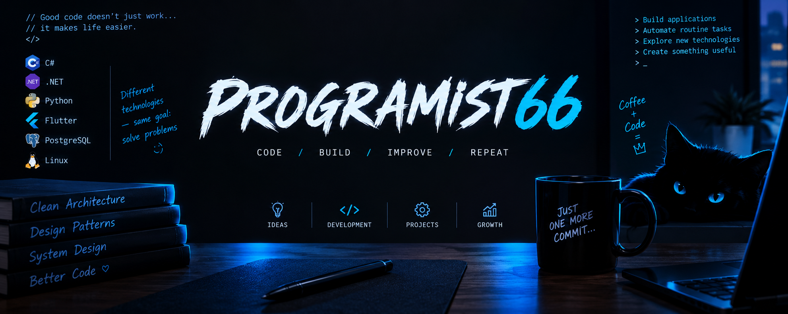

<p align="center">
  
</p>

<h1 align="center">👨‍💻 Hey, I'm Programist66!</h1>

<p align="center">
  Developer by profession. Problem solver by nature.
  Bug creator by accident. 🐛
</p>

---

## ⚡ About Me

I'm a developer who enjoys exploring technology, solving real-world problems, and turning ideas into working applications.

I don't stick to just one kind of project. From backend services and desktop applications to mobile experiments, automation, and educational projects — if there's an interesting problem to solve, I'm in.

- 🛠️ I build applications, tools, and side projects.
- 🧠 I enjoy understanding how things work under the hood.
- 🔌 I'm interested in APIs, networking, automation, and system integration.
- 📚 I explore new technologies and share knowledge through code.
- 🚀 I believe the best way to learn something is to build it.

> **My philosophy:** Write code that solves problems, not code that creates new ones.  
> And if it creates new ones... well, that's what debugging is for. 😄

---

## 🧰 Tech Stack

<p align="center">
  
</p>

### Areas I Explore

| Area | Technologies |
|---|---|
| 💻 Backend & APIs | C#, ASP.NET Core, REST APIs |
| 🖥️ Desktop Development | .NET, WPF |
| 📱 Mobile Development | Flutter, Dart |
| 🐍 Programming & Scripting | Python, C++ |
| 🗄️ Databases | PostgreSQL, SQLite |
| ⚙️ Infrastructure & Tools | Linux, Docker, Git, networking |

*Technologies shown reflect my development interests and projects, not a claim of equal expertise in every tool.*

---

## 🚀 Projects Worth Exploring

Here are a few projects from my repositories to get started.

<table>
  <tr>
    <td width="50%">
      <h3>🤖 Bot Constructor</h3>
      <p>A Telegram bot that creates a website from photos.</p>
      <a href="https://github.com/Programist66/bot_constructor">
        
      </a>
    </td>
    <td width="50%">
      <h3>♟️ Problem with Horses</h3>
      <p>A chessboard-related programming problem and its solution.</p>
      <a href="https://github.com/Programist66/problem_with_horses">
        
      </a>
    </td>
  </tr>
  <tr>
    <td width="50%">
      <h3>👾 Monster Fight</h3>
      <p>A game project focused on implementing gameplay logic.</p>
      <a href="https://github.com/Programist66/monster_fight">
        
      </a>
    </td>
    <td width="50%">
      <h3>🔢 Sudoku</h3>
      <p>A classic puzzle project built around logic and problem-solving.</p>
      <a href="https://github.com/Programist66/sudoku">
        
      </a>
    </td>
  </tr>
</table>

<p align="center">
  <a href="https://github.com/Programist66?tab=repositories">
    
  </a>
</p>

---

## 📊 GitHub at a Glance

<p align="center">
  
  
</p>

<p align="center">
  
</p>

<p align="center">
  
</p>

---

## 🎯 What Drives Me

```text
Curiosity   ████████████████████  100%
Problem-solving ██████████████████  90%
Experimenting  ███████████████████ 95%
Learning       ████████████████████ 100%
Sleeping       ERROR: Process interrupted by an idea
```

*Percentages are for fun, not performance metrics.* 😉

---

## 🤝 Let's Connect

I'm always happy to explore interesting ideas, discuss technology, exchange knowledge, and discover projects worth contributing to.

<p align="center">
  <a href="https://github.com/Programist66">
    
  </a>
</p>

<p align="center">
  ⭐ If something here catches your eye, check out the repositories and leave a star if you find something useful.
</p>

---

<p align="center">
  <i>Building things. Breaking things. Learning things. Repeating.</i>
  <br>
  <b>Thanks for stopping by! 👋</b>
</p>
